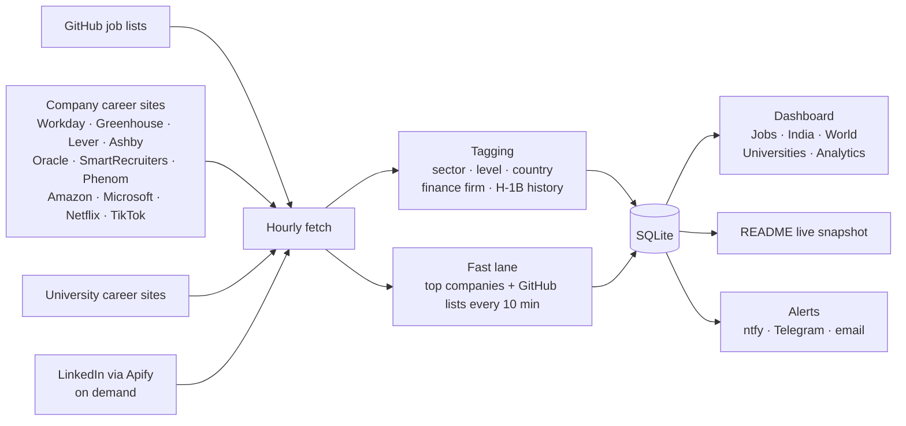

<p align="center">
  <picture>
    <source media="(prefers-color-scheme: dark)" srcset="assets/logo-dark.svg">
    
  </picture>
</p>

<p align="center">
  <b>One private dashboard for the whole job hunt:</b> every new opening from 200+ sources, real H‑1B sponsorship data,<br>
  separate views for the US, India and the rest of the world, and analytics on your own applications.
</p>

<p align="center">
  
  
  
  
  
</p>

---

## 📡 Live snapshot

This section is rewritten by the portal itself after every full refresh.

<!-- LIVE:START (auto-generated, do not edit by hand) -->

**Last updated: Oct 26, 2026 at 11:35 AM EDT** · fast lane every 10 min · everything every 30 min

| Right now in the portal | |
|---|---|
| 🇺🇸 United States | **93,121** |
| 🇮🇳 India | **11,549** |
| 🌍 Other countries | **18,063** |
| 🎓 University jobs | **3,930** |
| 🆕 Posted in the last 24 hours | **1,255** |
| ✅ US jobs at employers with H-1B history | **69,303 (74%)** |
| 💻 Software Engineering | **25,377** |
| 📊 Data Science & ML | **14,701** |
| 🏦 Finance & Banks | **66,046** |
| 🔌 Sources | **22 GitHub lists · 207 company career sites · 12 universities · LinkedIn (Apify)** |

**Freshest early-career tech & data roles at employers with H-1B history**

| Company | Role | Location | Posted | H-1B approvals (FY23) | |
|---|---|---|---|---|---|
| **Analog Devices** | DevOps Co-op | Boston, MA | 38 min ago | 41 | [Apply ↗](https://go.vansh.nyc/Qf) |
| **Pattern** | Revenue Operations Data Analyst Intern | Lehi, UT | 52 min ago | 1 | [Apply ↗](https://jobs.lever.co/pattern/84c10630-d414-4ad6-a195-05b0691fa97a/apply) |
| **Booz Allen** | University - 2027 Summer Games Systems Engineer Intern -… | Lexington, MA | 1h ago | 9 | [Apply ↗](https://bah.wd1.myworkdayjobs.com/bah_jobs/job/Lexington-MA/University---2027-Summer-Games-Systems-Engineer-Intern---Lexington--MA_R0252273?utm_source=understudy&ref=understudy-list) |
| **Meta** | Research Intern - Embedded AI on Wearables - PhD | Redmond, WA | 1h ago | 1,540 | [Apply ↗](https://www.metacareers.com/jobs/4070678619908522) |
| **Manhattan Associates** | Cloud Intern | Atlanta, GA | 1h ago | 45 | [Apply ↗](https://go.vansh.nyc/MX) |
| **PTC** | Software Engineer Intern (Summer 2027) | Boston, MA, USA | 2h ago | 19 | [Apply ↗](https://zapply.jobs/l/d/workday-ptc-ptc-JR112943?s=gh-new-grad-jobs-2027) |
| **Microsoft** | Applied Sciences INTERN | United States | 10h ago | 2,066 | [Apply ↗](https://zapply.jobs/l/d/microsoft-200041777?s=gh-new-grad-data-science-jobs-2027) |
| **Catalent** | 2027 Intern - IT | Madison, WI | 10h ago | 19 | [Apply ↗](https://catalent.wd1.myworkdayjobs.com/external/job/Madison-WI/XMLNAME-2027-Intern---IT_0097277?utm_source=understudy&ref=understudy-list) |
| **Hewlett Packard Enterprise** | AI/ML Developer Intern | San Jose, CA | 12h ago | 167 | [Apply ↗](https://go.vansh.nyc/BM) |
| **Salesforce** | Commercial/Enterprise Account Executive, Salesforce Analy… | Illinois Chicago | 15h ago | 498 | [Apply ↗](https://zapply.jobs/l/d/workday-salesforce-external-career-site-JR354555?s=gh-new-grad-jobs-2027) |
| **JPMorgan Chase** | Quantitative Research \[Multiple Positions Available\] | New York, NY, United States | 15h ago | 1,525 | [Apply ↗](https://zapply.jobs/l/d/oracle-jpmorgan-chase-210801267?s=gh-new-grad-data-science-jobs-2027) |
| **Evolent** | Associate Software Engineer | Remote in USA | 15h ago | 3 | [Apply ↗](https://evolent.wd1.myworkdayjobs.com/External/job/Work-at-Home/Associate-Software-Engineer_JR-916896) |
| **Interface** | Data Coordinator | LaGrange, GA | 15h ago | 5 | [Apply ↗](https://interface.wd1.myworkdayjobs.com/interface/job/LaGrange-GA/Data-Coordinator_R4332) |
| **Wells Fargo** | Technology Intern - Early Careers - Data Engineering | Iselin, Woodbridge Township… | 15h ago | 233 | [Apply ↗](https://wd1.myworkdaysite.com/recruiting/wf/WellsFargoJobs/job/CHARLOTTE-NC/XMLNAME-2027-Technology-Summer-Internship---Early-Careers--Data-Engineering-_R-583066) |
| **Skydio** | PhD Autonomy Engineer Intern - Deep Learning / Computer V… | San Mateo, California, Unit… | 16h ago | 13 | [Apply ↗](https://zapply.jobs/l/d/ashby-skydio-f1a72f5b-6157-47c1-8de9-379a32c7419f?s=gh-internships-2027) |

<!-- LIVE:END -->

---

## ✨ What it does

| | |
|---|---|
| 🗂 **One table for every opening** | Jobs from GitHub job lists, 200+ employers' own career sites, 12 university career sites and LinkedIn (through Apify), de-duplicated and refreshed every 30 minutes (top companies and the GitHub lists every 10). |
| ⏱ **Honest "posted" times** | `12m`, `3h`, `0d`, `2d` with the exact date. Sources that only give the day say "Today" instead of inventing a time. |
| 🛂 **Real H‑1B data** | Each employer's actual approval count from the official USCIS H‑1B Employer Data Hub (FY2023). The posting's own words ("no sponsorship", "US citizens only") always win. |
| 🏦 **Finance firm column** | 107 firms in 11 categories: broad banks, global banks, investment banking, asset managers, private markets, hedge funds, market makers, exchanges, payments, financial data, fintech. |
| ⭐ **Top companies tab** | FAANG / MAANG, big tech, top AI labs and the biggest finance names, with each company's measured posting pattern ("Microsoft: 12–3 PM ET, Mon · Tue · Thu"). Their career sites are re-checked every 10 minutes. |
| 📱 **Phone, Telegram & email alerts** | Free: through the ntfy app and/or your own Telegram bot. New matching roles at top companies within about 10 minutes, a heads-up just before a company's usual posting window, a ☀️ morning summary, and quiet hours at night. |
| 🌍 **Three regions** | 🇺🇸 United States · 🇮🇳 India (by city) · 🌍 Other countries (by country). The country is worked out from each job's location. |
| 🎓 **Universities** | Harvard, Stanford, Yale, UPenn, UChicago, CMU, Cornell and more: usually H‑1B cap-exempt employers. |
| ✅ **Status on every job** | Click the box on the left to mark a job **applied** (green). Hold it (or right-click) for a menu: ✓ Applied · ⏸ Wait / checkpoint (amber) · ✗ Decline (red). Applied jobs move through *interviewing → offer / rejected*. |
| 📊 **Analytics** | Applications per day, by sector, by finance category, pipeline funnel, country, level, top companies, how fast you apply after posting, weekday and source. |
| 💸 **LinkedIn budget guard** | LinkedIn jobs come through Apify, which is paid per job. The button shows money and clicks left this month, each fetch reports what it cost, and you're alerted at 50 / 80 / 95 % of the monthly allowance. |
| 🩺 **Self-healing** | The portal checks itself every 5 minutes and restarts cleanly if it loses access to its files; an optional watchdog brings it back automatically. |
| 🤖 **Ask all LLMs** | One prompt to ChatGPT, Claude, Gemini and others, answers side by side. |
| 📋 **Quick-copy bar** | Your LinkedIn, GitHub and saved answers one click away while filling in applications. |
| 🔐 **Safe to put online** | Built-in sign-in: scrypt-hashed password, optional authenticator codes, lockout, expiring sessions, cross-site request blocking. |

## 🧭 How it works



## 🚀 Quick start (macOS)

```bash
git clone https://github.com/jai0812/job_portal.git
cd job_portal
./run.sh
```

Open <http://localhost:8787>. The first start creates a virtual environment, installs the packages and fetches jobs.

Optional extras:

| Want | Do |
|---|---|
| A Desktop icon that starts it | `./desktop/install.sh` |
| LinkedIn searches | Put an Apify token in `.env` (`cp .env.example .env`) |
| AI answers in "Ask all LLMs" | Put OpenAI / Anthropic API keys in `.env` |
| Use it from anywhere on your own domain | See **[DEPLOY.md](DEPLOY.md)**: password first, then a free Cloudflare Tunnel |
| Job alerts on your phone | **Settings → 📱 Phone & email alerts**: subscribe to your topic in the ntfy app, or connect a Telegram bot from @BotFather |
| Restart automatically if it ever stops | `./desktop/install.sh --watchdog` |

## 🆕 What's new

**October 2026**
- **⭐ Top companies tab**: FAANG / MAANG, big tech, top AI labs and major finance firms in one view, with a card for each company showing **when it usually posts**. This is measured from the minute each company's own career site published its jobs over the last 60 days, e.g. *Microsoft 12–3 PM ET, Mon · Tue · Thu*.
- **Fast lane**: 31 top companies' career sites and all GitHub lists are re-checked every 10 minutes; everything else every 30.
- **Alerts** through ntfy and Telegram (both free): new roles, posting-window heads-ups, morning summary.
- **Job status box**: applied ✓ (green) · wait ⏸ (amber) · decline ✗ (red), with a press-and-hold menu.
- **LinkedIn (Apify)** made reliable (each search runs on its own; a slow one can't lose the others' results), trimmed to ≈ $0.33 per fetch, with spending shown on the button and budget alerts.
- **9 more GitHub job lists** (≈ 3,400 more jobs), including one with an H‑1B column the portal now reads.
- **FAANG / MAANG and 100+ top tech companies** read straight from their own career sites, plus Nike, Disney, Verizon and other H‑1B sponsors (tech roles only).
- **Fixes**: TikTok and Netflix no longer show made-up posting times; the portal restarts cleanly if macOS takes away its file access.

## ⚙️ Make it yours

Everything is plain YAML in [`config/`](config):

| File | What you edit |
|---|---|
| `sources.yaml` | GitHub job lists, LinkedIn searches, refresh interval, the fast-lane company list, how many days of jobs to keep |
| `finance_firms.yaml` | Finance firms, their categories and career-site feeds |
| `more_companies.yaml` | FAANG / MAANG, big tech, top tech, India tech and other H‑1B sponsors (`tech_only: true` keeps just IT / software / data / ML roles) |
| `universities.yaml` | Universities and their career-site feeds |
| `companies.yaml` | "Top company" and cap-exempt lists |

Add a GitHub job list from **Settings** in the app, or paste any repo URL into `sources.yaml`: SimplifyJobs-style `listings.json`, Markdown or HTML tables, and one-section-per-company lists are all understood.

## 🔌 Where the jobs come from

- **GitHub lists (22):** SimplifyJobs, SpeedyApply, JobRight, SWE Job Lists (H‑1B labelled), Zapply (new grad, data science, software, internships), ApplyGuy, Understudy, Northwestern Fintech quant internships and more.
- **Finance firms' own sites:** JPMorgan, Bank of America, Citi, Morgan Stanley, BlackRock, Fidelity, Franklin Templeton, Blackstone, Jane Street, HRT, Optiver, Nasdaq, CME, Visa, Mastercard, Stripe and about 60 more.
- **Tech companies' own sites:** Amazon, Microsoft, Netflix, NVIDIA, Salesforce, Adobe, Intel, Cisco, TikTok, LinkedIn, Airbnb, Databricks, Snowflake, DoorDash, Anthropic, OpenAI and about 90 more.
- **Other H‑1B sponsors (tech roles only):** Nike, Disney, Verizon, T‑Mobile, Medtronic, Pfizer, Moderna and others.
- **India:** Paytm, Meesho, CRED, Groww, Sarvam AI, InMobi and the India offices of the companies above.
- **Universities:** Harvard, Stanford, Yale, UPenn, UChicago, CMU, Cornell, Northeastern, UW, UT Austin, Maryland, Rochester.

Google, Meta, Apple and Uber don't allow their career sites to be read automatically; their roles arrive through the GitHub lists and an optional LinkedIn search.

## 🗂 Project layout

```
app/main.py              web server and API
app/fetchers/            github.py · careers.py (11 career-site systems) · apify.py
app/classify.py          sector, level and H-1B wording
app/finance.py           finance firm matching        app/h1b.py   USCIS approval lookup
app/geo.py               country detection            app/auth.py  sign-in and sessions
app/patterns.py          when each company posts      app/alerts.py  phone / email alerts (ntfy)
app/readme.py            keeps the live snapshot above up to date
static/                  the dashboard (plain HTML, CSS and JavaScript)
config/                  sources, companies, universities, USCIS FY2023 data
scripts/                 fetch_jobs.py · set_password.py · go_online.sh
desktop/                 macOS Desktop launcher
```

More detail on every feature is in **[docs/GUIDE.md](docs/GUIDE.md)**.

## 🔒 Privacy

Your API keys and password hash (`.env`) and your personal data (`data/`: job database, applied history, notes) are listed in `.gitignore` and never leave your computer. The live snapshot above contains only public job-market numbers.

## ⚠️ Good to know

- H‑1B figures are past approvals from public USCIS data. They don't guarantee that a particular role sponsors; confirm with the employer. Nothing here is legal or immigration advice.
- Job postings belong to their employers and to the lists that collect them. The portal reads public pages politely (hourly, rate-limited) for personal use.
- Built and tested on macOS.

---

<p align="center">
  Built by <b>Jai Sharma</b> · <a href="https://sharmajai.com">sharmajai.com</a>
</p>
