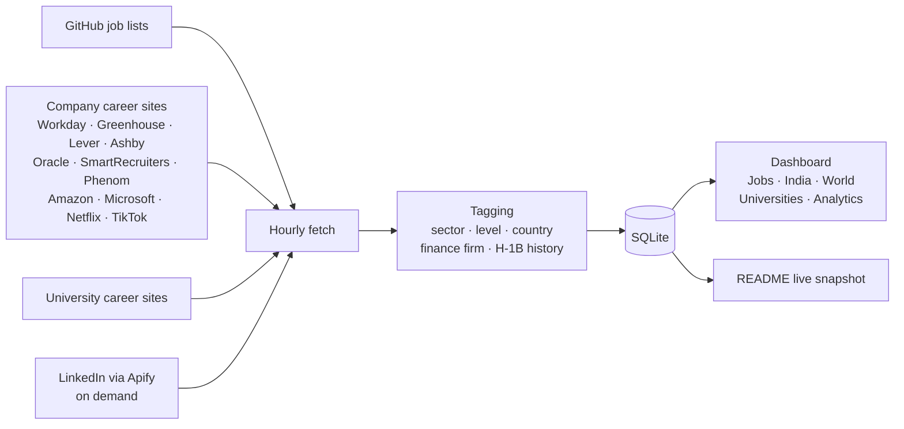

<p align="center">
  <picture>
    <source media="(prefers-color-scheme: dark)" srcset="assets/logo-dark.svg">
    
  </picture>
</p>

<p align="center">
  <b>One private dashboard for the whole job hunt:</b> every new opening from 200+ sources, real H‑1B sponsorship data,<br>
  separate views for the US, India and the rest of the world, and analytics on your own applications.
</p>

<p align="center">
  
  
  
  
  
</p>

---

## 📡 Live snapshot

This section is rewritten by the portal itself after every hourly refresh.

<!-- LIVE:START (auto-generated, do not edit by hand) -->

**Last updated: Oct 13, 2026 at 3:31 PM EDT** · refreshed automatically every hour

| Right now in the portal | |
|---|---|
| 🇺🇸 United States | **66,277** |
| 🇮🇳 India | **9,923** |
| 🌍 Other countries | **13,978** |
| 🎓 University jobs | **3,709** |
| 🆕 Posted in the last 24 hours | **2,662** |
| ✅ US jobs at employers with H-1B history | **52,046 (79%)** |
| 💻 Software Engineering | **17,467** |
| 📊 Data Science & ML | **10,348** |
| 🏦 Finance & Banks | **50,346** |
| 🔌 Sources | **13 GitHub lists · 207 company career sites · 12 universities · LinkedIn (Apify)** |

**Freshest early-career tech & data roles at employers with H-1B history**

| Company | Role | Location | Posted | H-1B approvals (FY23) | |
|---|---|---|---|---|---|
| **Microsoft** | Research Intern - Machine Learning for Biology and Health… | Cambridge, Massachusetts, U… | 32 min ago | 2,066 | [Apply ↗](https://apply.careers.microsoft.com/careers/job/1970393557040333) |
| **Skydio** | Embedded Software Engineer Intern - Summer 2027 | San Mateo, California, Unit… | 1h ago | 13 | [Apply ↗](https://jobs.ashbyhq.com/skydio/8994767e-fd53-4ca2-b0ef-fe0923c1e260) |
| **Figma** | PhD Intern, Software Engineer - Graphics (2027) | San Francisco, CA • New Yor… | 3h ago | 10 | [Apply ↗](https://boards.greenhouse.io/figma/jobs/6219995004?gh_jid=6219995004) |
| **Axtria** | AI & Data Associate | Berkeley Heights, NJ | 5h ago | 74 | [Apply ↗](https://axtriainc.applytojob.com/apply/WvWFVnBuU0/Campus-2027-AI-Data) |
| **Vertiv** | Data Analytics Intern | Delaware, OH | 5h ago | 4 | [Apply ↗](https://egup.fa.us2.oraclecloud.com/hcmUI/CandidateExperience/en/sites/CX/job/20278852) |
| **Vestmark** | Software Engineer Co-op | Boston, MA | 5h ago | 1 | [Apply ↗](https://job-boards.greenhouse.io/vestmark/jobs/8204509) |
| **Experian** | Associate Machine Learning Scientist | Sofia, BG | 12h ago | 36 | [Apply ↗](https://jobs.smartrecruiters.com/Experian/744000155170869) |
| **Western Digital** | Junior IT Developer | Bayan Lepas, Penang, MY | 18h ago | 56 | [Apply ↗](https://jobs.smartrecruiters.com/WesternDigital/744000155153462) |
| **TikTok** | Research Scientist Graduate | Seattle, WA | 18h ago | 475 | [Apply ↗](https://lifeattiktok.com/search/7695929967028750645) |
| **Meta** | Research Scientist Intern - Language and Agents | Menlo Park, CA · Bellevue,… | 18h ago | 1,540 | [Apply ↗](https://www.metacareers.com/jobs/2168438160696161) |
| **Chewy** | Business Intelligence Analyst 1 | Dayton, OH · Houston, TX ·… | 19h ago | 90 | [Apply ↗](https://wd5.myworkdaysite.com/recruiting/chewy/External/job/Clayton-IN/Business-Intelligence-Analyst-I_R31111) |
| **General Dynamics Informatio…** | Software Developer Intern - Defense Agencies - Software D… | Falls Church, VA | 19h ago | 12 | [Apply ↗](https://gdit.wd5.myworkdayjobs.com/gdit_earlytalent/job/USA-VA-Falls-Church/XMLNAME-2027-Summer-Intern---Defense-Agencies--SW-DEV-_RQ230270) |
| **Siemens** | Sales and Service Web Development Intern - Gscs | Mason, OH | 21h ago | 6 | [Apply ↗](https://siemens.avature.net/en_US/externaljobs/JobDetail/525502) |
| **Momentum Engineering** | Software Engineer 0 | Annapolis Junction, MD | 21h ago | 1 | [Apply ↗](https://ats.rippling.com/momentumcareers/jobs/dbcd3c46-e2fa-4d75-8da1-ac8d15d3771e) |
| **Ascension** | Master Data Management Intern | St. Louis, MO | 21h ago | 22 | [Apply ↗](https://jobs.ascension.org/us/en/job/2026-465180) |

<!-- LIVE:END -->

---

## ✨ What it does

| | |
|---|---|
| 🗂 **One table for every opening** | Jobs from GitHub job lists, 200+ employers' own career sites, 12 university career sites and LinkedIn (through Apify), de-duplicated and refreshed every hour. |
| ⏱ **Honest "posted" times** | `12m`, `3h`, `0d`, `2d` with the exact date. Sources that only give the day say "Today" instead of inventing a time. |
| 🛂 **Real H‑1B data** | Each employer's actual approval count from the official USCIS H‑1B Employer Data Hub (FY2023). The posting's own words ("no sponsorship", "US citizens only") always win. |
| 🏦 **Finance firm column** | 107 firms in 11 categories: broad banks, global banks, investment banking, asset managers, private markets, hedge funds, market makers, exchanges, payments, financial data, fintech. |
| 🌍 **Three regions** | 🇺🇸 United States · 🇮🇳 India (by city) · 🌍 Other countries (by country). The country is worked out from each job's location. |
| 🎓 **Universities** | Harvard, Stanford, Yale, UPenn, UChicago, CMU, Cornell and more: usually H‑1B cap-exempt employers. |
| ✅ **Applied tracking** | Tick a box when you apply; move jobs through *interviewing → offer / rejected*. |
| 📊 **Analytics** | Applications per day, by sector, by finance category, pipeline funnel, country, level, top companies, how fast you apply after posting, weekday and source. |
| 🤖 **Ask all LLMs** | One prompt to ChatGPT, Claude, Gemini and others, answers side by side. |
| 📋 **Quick-copy bar** | Your LinkedIn, GitHub and saved answers one click away while filling in applications. |
| 🔐 **Safe to put online** | Built-in sign-in: scrypt-hashed password, optional authenticator codes, lockout, expiring sessions, cross-site request blocking. |

## 🧭 How it works



## 🚀 Quick start (macOS)

```bash
git clone https://github.com/jai0812/job_portal.git
cd job_portal
./run.sh
```

Open <http://localhost:8787>. The first start creates a virtual environment, installs the packages and fetches jobs.

Optional extras:

| Want | Do |
|---|---|
| A Desktop icon that starts it | `./desktop/install.sh` |
| LinkedIn searches | Put an Apify token in `.env` (`cp .env.example .env`) |
| AI answers in "Ask all LLMs" | Put OpenAI / Anthropic API keys in `.env` |
| Use it from anywhere on your own domain | See **[DEPLOY.md](DEPLOY.md)**: password first, then a free Cloudflare Tunnel |

## ⚙️ Make it yours

Everything is plain YAML in [`config/`](config):

| File | What you edit |
|---|---|
| `sources.yaml` | GitHub job lists, LinkedIn searches, refresh interval, how many days of jobs to keep |
| `finance_firms.yaml` | Finance firms, their categories and career-site feeds |
| `more_companies.yaml` | FAANG / MAANG, big tech, top tech, India tech and other H‑1B sponsors (`tech_only: true` keeps just IT / software / data / ML roles) |
| `universities.yaml` | Universities and their career-site feeds |
| `companies.yaml` | "Top company" and cap-exempt lists |

Add a GitHub job list from **Settings** in the app, or paste any repo URL into `sources.yaml`: SimplifyJobs-style `listings.json`, Markdown or HTML tables, and one-section-per-company lists are all understood.

## 🔌 Where the jobs come from

- **GitHub lists:** SimplifyJobs (new grad, internships), SpeedyApply (SWE, AI/ML), JobRight (software, data, accounting & finance, business analyst), Northwestern Fintech quant internships.
- **Finance firms' own sites:** JPMorgan, Bank of America, Citi, Morgan Stanley, BlackRock, Fidelity, Franklin Templeton, Blackstone, Jane Street, HRT, Optiver, Nasdaq, CME, Visa, Mastercard, Stripe and about 60 more.
- **Tech companies' own sites:** Amazon, Microsoft, Netflix, NVIDIA, Salesforce, Adobe, Intel, Cisco, TikTok, LinkedIn, Airbnb, Databricks, Snowflake, DoorDash, Anthropic, OpenAI and about 90 more.
- **Other H‑1B sponsors (tech roles only):** Nike, Disney, Verizon, T‑Mobile, Medtronic, Pfizer, Moderna and others.
- **India:** Paytm, Meesho, CRED, Groww, Sarvam AI, InMobi and the India offices of the companies above.
- **Universities:** Harvard, Stanford, Yale, UPenn, UChicago, CMU, Cornell, Northeastern, UW, UT Austin, Maryland, Rochester.

Google, Meta, Apple and Uber don't allow their career sites to be read automatically; their roles arrive through the GitHub lists and an optional LinkedIn search.

## 🗂 Project layout

```
app/main.py              web server and API
app/fetchers/            github.py · careers.py (11 career-site systems) · apify.py
app/classify.py          sector, level and H-1B wording
app/finance.py           finance firm matching        app/h1b.py   USCIS approval lookup
app/geo.py               country detection            app/auth.py  sign-in and sessions
app/readme.py            keeps the live snapshot above up to date
static/                  the dashboard (plain HTML, CSS and JavaScript)
config/                  sources, companies, universities, USCIS FY2023 data
scripts/                 fetch_jobs.py · set_password.py · go_online.sh
desktop/                 macOS Desktop launcher
```

More detail on every feature is in **[docs/GUIDE.md](docs/GUIDE.md)**.

## 🔒 Privacy

Your API keys and password hash (`.env`) and your personal data (`data/`: job database, applied history, notes) are listed in `.gitignore` and never leave your computer. The live snapshot above contains only public job-market numbers.

## ⚠️ Good to know

- H‑1B figures are past approvals from public USCIS data. They don't guarantee that a particular role sponsors; confirm with the employer. Nothing here is legal or immigration advice.
- Job postings belong to their employers and to the lists that collect them. The portal reads public pages politely (hourly, rate-limited) for personal use.
- Built and tested on macOS.

---

<p align="center">
  Built by <b>Jai Sharma</b> · <a href="https://sharmajai.com">sharmajai.com</a>
</p>
